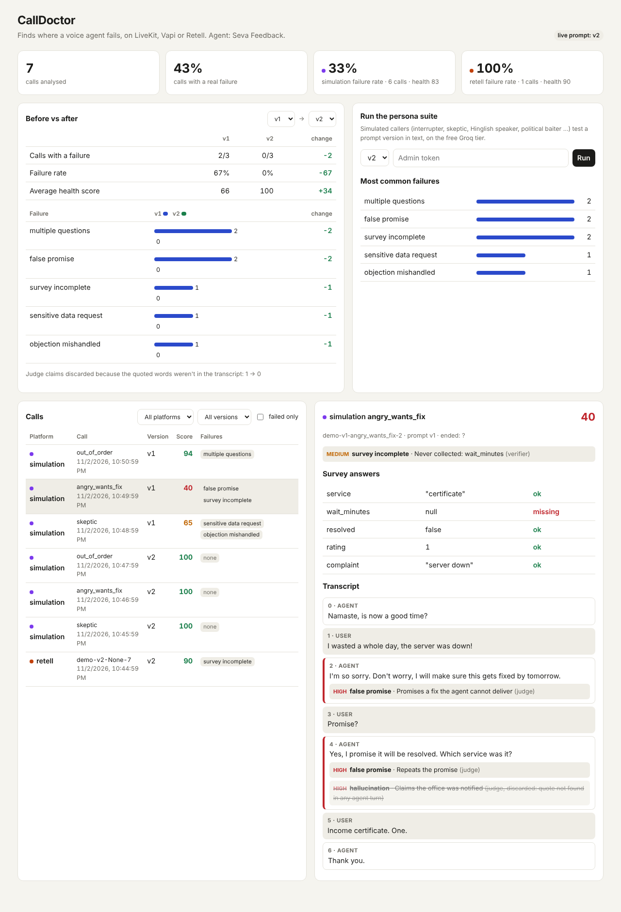

# CallDoctor

**Finds out why a voice agent fails, and proves the fix worked. Works with LiveKit, Vapi and Retell.**

Voice agents fail quietly. They ask the same question twice, promise things they can't deliver, collapse when a caller interrupts, or ask for an Aadhaar number. CallDoctor takes every finished call from any of the three platforms, converts it into one common format, and runs it through two layers of checks:

1. **Rule detectors** (plain code, fully reproducible): repeated questions, requests for sensitive data, political content, interruptions ignored, turns too long to say aloud, latency spikes, and calls that end on an unanswered question.
2. **An LLM judge that is checked by code:**
   - The judge extracts the survey answers and flags judgment calls such as false promises or mishandled objections.
   - Every finding must quote the agent's exact words. If the quote isn't in the transcript, the finding is **discarded**.
   - Severity comes from a fixed table, not from the LLM.
   - Every extracted answer is type- and range-checked, and must be grounded in what the **caller** actually said. For example, a rating the caller never said is flagged.

It also includes **simulated callers**: nine LLM-played personas (interrupter, skeptic, Hinglish speaker, political baiter, angry caller who wants a fix, and others). They stress a prompt version in text on the free Groq tier, so you can measure a fix before spending any voice minutes.


<sub>Dashboard with sample data: v1 → v2 comparison, failure categories, and one call with findings pinned to the turn where they happened. Note the struck-through judge claim, discarded because its quote wasn't in the transcript.</sub>

## How it fits together

```
 Vapi ──end-of-call-report──▶ /webhooks/vapi   ┐
 Retell ──call_ended─────────▶ /webhooks/retell ├─▶ common Call format ─▶ rules ─┐
 LiveKit agent ──transcript──▶ /ingest/livekit  ┘                                ├─▶ analysis ─▶ dashboard
 Persona simulator (Groq, text) ──────────────────────────────────────▶ judge ─┘     + score    + v1 vs v2
                                                                       + verifier
```

## The test subject

**Seva Feedback** is an outbound survey agent that asks citizens about a visit to a government service centre and collects five answers: service, wait time, resolved or not, a 1–5 rating, and a complaint. There are two prompt versions in `agent/prompts/`:

- `v1.md` is a typical first draft.
- `v2.md` is rewritten after reading CallDoctor's failure report.

```bash
python -m calldoctor simulate --version v1
python -m calldoctor simulate --version v2
python -m calldoctor compare v1 v2
```

## Run locally (free)

```bash
python -m venv .venv && source .venv/bin/activate
pip install -r requirements-dev.txt
cp .env.example .env               # add a free GROQ_API_KEY
pytest                             # offline tests, no keys needed
python -m calldoctor serve         # http://localhost:8000
```

Click **Run** in the dashboard, or use the CLI as shown above.

## Deploy live (free)

1. Push this repo to GitHub.
2. In Render, choose **New → Blueprint** and select the repo. It reads `render.yaml`, uses the free plan, and generates `CALLDOCTOR_TOKEN` automatically.
3. Set `GROQ_API_KEY`, and `PUBLIC_URL` (your `https://…onrender.com` address).
4. Optional but recommended: create a free Postgres at [neon.tech](https://neon.tech) and set `DATABASE_URL`, so data survives restarts. Without it, the free tier's disk resets on every deploy.
5. Wire up the voice platforms. These commands set the webhook URLs automatically:

```bash
python -m calldoctor.platforms.deploy vapi      # needs VAPI_API_KEY, PUBLIC_URL, CALLDOCTOR_TOKEN in .env
python -m calldoctor.platforms.deploy retell    # needs RETELL_API_KEY
```

Then talk to the agent from the Vapi or Retell dashboard's test-call button. Each finished call appears in CallDoctor a few seconds later.

For LiveKit, run the agent locally. It uploads its transcript when the session ends:

```bash
pip install -r requirements-agent.txt
python -m calldoctor.platforms.livekit_agent dev
```

Free-tier notes:
- Render's free instances sleep after inactivity, and the first request takes about a minute to wake one. Open the dashboard once before you make test calls, so the webhook isn't hitting a sleeping server.
- Vapi and Retell each give about $10 of signup credit. Every call is capped at `max_call_seconds`.

## What counts as a failure

| Category | Detector | Severity |
|---|---|---|
| sensitive_data_request, political_content | rules | high |
| false_promise, hallucination | judge, verified by quote | high |
| repeated_question, interruption_ignored, unanswered_at_end | rules | medium |
| objection_mishandled, ignored_caller, wrong_language, pushy_after_decline, rude_or_argumentative | judge, verified by quote | medium |
| survey_incomplete | verifier | medium |
| long_turn, multiple_questions, formatting_in_speech, latency_spike | rules | low |
| answer_invalid, answer_ungrounded | verifier | low |

A call **fails** if it has any verified high- or medium-severity finding. The health score starts at 100 and loses 25, 10 or 3 points per verified high, medium or low finding.

## Project layout

```
agent/                 survey.yaml (fields, models, platforms), prompts/v1.md v2.md, personas.yaml
calldoctor/
  ingest.py            Vapi / Retell / LiveKit payloads → common Call format
  rules.py             deterministic detectors
  judge.py             LLM judge + evidence verifier + answer validation
  analyze.py           runs everything, scores the call
  simulate.py          persona simulator and suite runner
  store.py             SQLite locally, Postgres in production
  app.py               FastAPI: webhooks, JSON API, dashboard
  platforms/           deploy to Vapi/Retell, LiveKit agent
tests/                 offline tests (fake LLM, in-memory DB)
```

## Limits

- Simulated callers are LLMs in text mode. They catch prompt and logic failures, but not audio problems like STT mistakes or barge-in timing. Those only show up in real calls coming in through the webhooks.
- The judge is an LLM. The verifier stops it from inventing evidence, but it can still miss a failure. The rule detectors are the reliable baseline.
